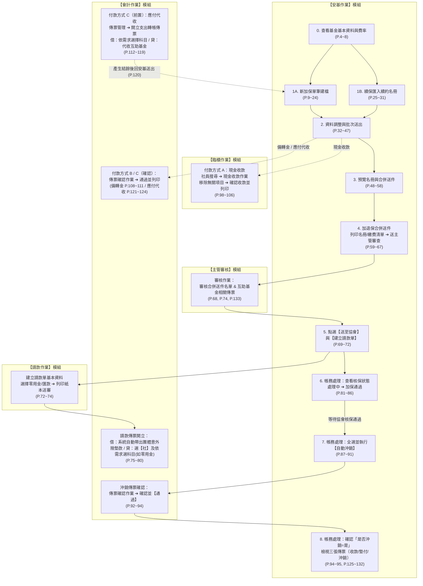

# 安基作業（協會代辦互助基金）精簡版 SOP 速查手冊

> **文件說明**
> 本手冊將原 **133 頁**《安基作業教學_20260819 (1).pdf》簡報濃縮為**跨系統標準作業流程（SOP）速查表**。
> - 每個步驟皆標註**所屬系統模組**與**原簡報對應頁碼 (`P.xx`)**，點擊連結可直接開啟對應的高解析截圖（`assets/slides/page_xxx.jpg`）。
> - 若需雙欄互動式步進檢視、關鍵字即時搜尋與勾選進度保存，請直接以瀏覽器開啟同目錄下的 [`index.html`](index.html)。

---

## 一、全流程跨系統鳥瞰圖（Swimlane 流程圖）

安基作業（協會代辦互助基金）的核心難點在於**「跨 5 大系統模組切換」**。以下流程圖標示從加保／續保、收款／轉帳、合併送件、請款墊付，到核保通過後自動沖銷的完整路徑：

---

## 二、三大付款方式速查對照表（P.21~24、P.96~124）

在「新加保」或「調整資料」選擇【付款方式】時，三種付款方式的跨系統操作順序完全不同，請特別注意**「應付代收」必須先去會計作業開立傳票才有結餘**：

| 比較項目 | 1. 現金收款 (`P.22`, `P.98~106`) | 2. 備轉金 (`P.23`, `P.107~111`) | 3. 應付代收 (`P.24`, `P.112~124`) |
| :--- | :--- | :--- | :--- |
| **適用情境** | 社員現場或臨櫃繳交現金（無預收款） | 扣抵社員既有備轉金帳戶餘額 | 由會計轉帳轉入代收互助基金 |
| **前置條件（安基送出前）** | 無須先開傳票，に直接於安基選擇【現金收款】後暫存並送出 | 確認備轉金有結餘，於安基選擇【備轉金】後暫存並送出 | **必須先至【會計作業】開立支出轉帳傳票**，否則安基畫面下方「結餘」為 `0` 無法扣款 |
| **跨系統操作路徑** | 1. **【安基作業】** 選「現金收款」送出 ([P.22](assets/slides/page_022.jpg)) 2. 切換至 **【臨櫃作業】** ➔ 點選【社員搜尋】輸入社員帳號 ([P.98~101](assets/slides/page_098.jpg)) 3. 點選【現金收款作業】，系統自動帶出代辦互助基金金額 ([P.102~103](assets/slides/page_102.jpg)) 4. **將其他無關項目【移除】** ([P.104](assets/slides/page_104.jpg)) 5. 點選【確認收款並列印收款單】完成開立 ([P.105~106](assets/slides/page_105.jpg)) | 1. **【安基作業】** 選「備轉金」暫存並送出 ([P.23](assets/slides/page_023.jpg), [P.107](assets/slides/page_107.jpg)) 2. 切換至 **【會計作業】** ➔ 點選【傳票確認作業】 ([P.108~109](assets/slides/page_108.jpg)) 3. 找到該張傳票，點選【通過並列印】即完成 ([P.110~111](assets/slides/page_110.jpg)) | 1. 先切換至 **【會計作業】** ➔【傳票管理】➔【開立傳票】（支出轉帳傳票） ([P.112~113](assets/slides/page_112.jpg)) 2. 新增**借方**：選社員帳號、依實際需求選擇會計科目、輸入金額 ([P.114~115](assets/slides/page_114.jpg)) 3. 新增**貸方**：科目選對應代收基金（如 `21515 代收重大疾病互助基金` 或 `21514 代收社員意外互助基金`）、輸入同金額後【送出】 ([P.116~119](assets/slides/page_116.jpg)) 4. 回到 **【安基作業】** 確認下方【結餘】已顯示金額 ➔ 先點【暫存】再按【送出】 ([P.120](assets/slides/page_120.jpg)) 5. 再切換回 **【會計作業】** ➔【傳票確認作業】➔ 找到傳票點選【通過並列印】 ([P.121~124](assets/slides/page_121.jpg)) |
| **防呆檢核重點** | 臨櫃收款畫面務必把**非本次互助基金的無關項目移除**，避免誤收其他款項 ([P.104](assets/slides/page_104.jpg)) | 若在傳票確認作業找不到傳票，請主管至【審核作業】審核 ([P.133](assets/slides/page_133.jpg)) | 若安基畫面下方【結餘】顯示 `0`，代表費用尚未轉入該互助基金科目 ([P.24](assets/slides/page_024.jpg)) |

---

## 三、分階段標準作業步驟（SOP Checklists）

### 階段一：介紹與加保申請（P.4 ~ P.24）

#### 1.1 查看互助基金基本資料與費率明細（`P.4 ~ P.8`）
- [ ] **Step 1** `【安基作業】` 點擊右上角【切換】➔ 點選【安基作業】 ([P.4](assets/slides/page_004.jpg))
- [ ] **Step 2** `【安基作業】` 點選左側選單【協會代辦互助基金】 ([P.5](assets/slides/page_005.jpg))
- [ ] **Step 3** `【安基作業】` 選擇要查看的互助基金（例：社員團體意外互助基金），點選右側「綠色鉛筆」編輯圖示 ([P.6](assets/slides/page_006.jpg))
- [ ] **Step 4** `【安基作業】` 於【基本資料】頁籤查看基金內容說明與參加年齡/資格限制 ([P.7](assets/slides/page_007.jpg))
- [ ] **Step 5** `【安基作業】` 點選【互助費與經辦費明細】頁籤，查看各計畫別之互助費、經辦費與保障金額 ([P.8](assets/slides/page_008.jpg))

#### 1.2 加保申請名冊管理－介面功能介紹（`P.9 ~ P.12`）
- [ ] **功能 A（進入名冊）** `【安基作業】` 點選左側選單【加保申請名冊】 ([P.9](assets/slides/page_009.jpg))
- [ ] **功能 B（新增加保）** `【安基作業】` 點選右上角【＋】按鈕，跳出【新加保】建檔視窗 ([P.10](assets/slides/page_010.jpg))
- [ ] **功能 C（跨頁全選）** `【安基作業】` 點選列表左上角【☐】（跨頁全選），一次勾選所有頁面的申請資料 ([P.11](assets/slides/page_011.jpg))
- [ ] **功能 D（批次刪除）** `【安基作業】` 勾選欲刪除的資料後，點選右上角【✕】即可刪除 ([P.12](assets/slides/page_012.jpg))

#### 1.3 新加保單筆申請流程（`P.13 ~ P.24`）
- [ ] **Step 1** `【安基作業】` 在【加保申請名冊】點選右上角【＋】開啟新加保視窗 ([P.13](assets/slides/page_013.jpg))
- [ ] **Step 2** `【安基作業】` 選擇【申請方案】（選擇保險年度如 `115`、子方案如 `計畫一`） ([P.14](assets/slides/page_014.jpg))
- [ ] **Step 3** `【安基作業】` 選擇【申請人】（點擊「請選擇社員」帶入社員） ([P.15](assets/slides/page_015.jpg))
- [ ] **Step 4** `【安基作業】` 確認帶出之社員基本資料，並填寫【職業】與【職稱】 ([P.16](assets/slides/page_016.jpg), [P.17](assets/slides/page_017.jpg))
- [ ] **Step 5** `【安基作業】` 選擇【受益人分配方式】：
  - 選項包含：`法定繼承人`、`平均分配`、`依照順序` ([P.18](assets/slides/page_018.jpg))
  - 若選「平均分配」或「依照順序」，需填寫下方受益人姓名、關係、身分證等資料；**若受益人只有一人，選「平均分配」或「依照順序」皆可** ([P.19](assets/slides/page_019.jpg))
- [ ] **Step 6** `【安基作業】` 輸入【獎勵或補助／其他扣除金額】，並選擇【預計生效日】 ([P.20](assets/slides/page_020.jpg))
- [ ] **Step 7** `【安基作業】` 選擇【付款方式】並檢查下方【結餘】 ([P.21](assets/slides/page_021.jpg))：
  - 選 **【現金收款】**：無預收款時使用，後續需至臨櫃作業收款 ([P.22](assets/slides/page_022.jpg))
  - 選 **【備轉金】**：扣抵備轉金，後續需至會計作業確認傳票 ([P.23](assets/slides/page_023.jpg))
  - 選 **【應付代收】**：檢查下方【結餘】是否有金額（若為 `0` 代表尚未於會計作業開立轉帳傳票轉入該基金）。確認有結餘後，**先點【暫存】再按【送出】** ([P.24](assets/slides/page_024.jpg))

---

### 階段二：加保通過前流程（續保、調整、合併送件、請款）（P.25 ~ P.86）

#### 2.1 續保流程－匯入續約名冊（`P.25 ~ P.31`）
- [ ] **Step 1** `【安基作業】` 於【加保申請名冊】點選上方【匯入續約名冊】按鈕 ([P.27](assets/slides/page_027.jpg))
- [ ] **Step 2** `【安基作業】` 選擇續保【年度】，點選【匯入】 ([P.28](assets/slides/page_028.jpg))
- [ ] **Step 3** `【安基作業】` 勾選本次要續約的社員名單 ([P.29](assets/slides/page_029.jpg))
- [ ] **Step 4** `【安基作業】` 點選【確認送出加保申請】 ([P.30](assets/slides/page_030.jpg))
- [ ] **Step 5** `【安基作業】` 回到【加保申請名冊】檢視已匯入之續保名單 ([P.31](assets/slides/page_031.jpg))

#### 2.2 調整資料（若資料無誤可略過）（`P.32 ~ P.44`）

##### 範例一：單筆手動調整（例：將現金收款改為應付代收）（`P.32 ~ P.37`）
- [ ] **Step 1** `【安基作業】` 點選欲修改社員右側的「綠色鉛筆」圖示 ([P.32](assets/slides/page_032.jpg))
- [ ] **Step 2** `【安基作業】` 點開【付款方式】下拉選單，改選為【應付代收】 ([P.33](assets/slides/page_033.jpg), [P.34](assets/slides/page_034.jpg))
- [ ] **Step 3** `【安基作業】` **先點選【暫存】，再按【送出】** ([P.35](assets/slides/page_035.jpg))
- [ ] **Step 4** `【安基作業】` 回到【加保申請名冊】，確認該筆社員的「申請送出狀態」已變為【已送出】 ([P.36](assets/slides/page_036.jpg), [P.37](assets/slides/page_037.jpg))

##### 範例二：多筆批次調整（先匯出 Excel 修改再匯入）（`P.38 ~ P.44`）
- [ ] **Step 1** `【安基作業】` 將欲調整的多筆社員資料勾選起來 ([P.38](assets/slides/page_038.jpg))
- [ ] **Step 2** `【安基作業】` 點選【匯出名冊】，從瀏覽器右上角下載匯出的 Excel 檔 ([P.39](assets/slides/page_039.jpg))
- [ ] **Step 3** `【Excel】` 開啟 Excel 檔，將「付款方式」欄位由原本的【現金收款】批次改為【應付代收】並存檔 ([P.40](assets/slides/page_040.jpg), [P.41](assets/slides/page_041.jpg))
- [ ] **Step 4** `【安基作業】` 回到系統點選【匯入名冊】，選擇剛剛修改存檔的 Excel 檔案上傳 ([P.42](assets/slides/page_042.jpg), [P.43](assets/slides/page_043.jpg))
- [ ] **Step 5** `【安基作業】` 畫面跳出「儲存成功」訊息即完成多筆更新 ([P.44](assets/slides/page_044.jpg))

#### 2.3 批次送出與預覽名冊（`P.45 ~ P.52`）
- [ ] **Step 1（批次送出）** `【安基作業】` 檢查列表中「申請送出狀態」為【未送出】的資料 ([P.45](assets/slides/page_045.jpg))
- [ ] **Step 2（批次送出）** `【安基作業】` 勾選這些未送出資料，點選上方【批次送出】，確認狀態皆轉為【已送出】 ([P.46](assets/slides/page_046.jpg), [P.47](assets/slides/page_047.jpg))
- [ ] **Step 3（預覽名冊）** `【安基作業】` 點擊左上角全選按鈕 `☐` 勾選全部資料 ([P.48](assets/slides/page_048.jpg), [P.49](assets/slides/page_049.jpg))
- [ ] **Step 4（預覽名冊）** `【安基作業】` 點選【預覽名冊】，下載右上角產生的 PDF 檔案並核對所有社員加保資料是否正確 ([P.50](assets/slides/page_050.jpg), [P.51](assets/slides/page_051.jpg), [P.52](assets/slides/page_052.jpg))

#### 2.4 合併送件與加退保合併送件審查（`P.53 ~ P.70`）
- [ ] **Step 1** `【安基作業】` 於【加保申請名冊】點擊全選按鈕 `☐` 勾選全部資料，點選【合併送件】 ([P.54](assets/slides/page_054.jpg), [P.55](assets/slides/page_055.jpg), [P.56](assets/slides/page_056.jpg))
- [ ] **Step 2** `【安基作業】` 畫面跳出「儲存成功，需至加退保合併送件，進行後續流程」，點選左側選單【加退保合併送件】 ([P.57](assets/slides/page_057.jpg), [P.58](assets/slides/page_058.jpg))
- [ ] **Step 3** `【安基作業】` 點選剛剛合併送件那筆資料右側的「綠色鉛筆」圖示進入明細 ([P.59](assets/slides/page_059.jpg))
- [ ] **Step 4** `【安基作業】` 點選【列印名冊】，開啟右上角下載的 PDF 再次確認名冊資料無誤 ([P.60](assets/slides/page_060.jpg), [P.61](assets/slides/page_061.jpg), [P.62](assets/slides/page_062.jpg))
- [ ] **Step 5** `【安基作業】` 點選【產生繳費清單】，開啟下載檔案確認社員繳費情形 ([P.63](assets/slides/page_063.jpg), [P.64](assets/slides/page_064.jpg), [P.65](assets/slides/page_065.jpg))
- [ ] **Step 6** `【安基作業】` 點選【確認名單，送主管審查】，畫面狀態顯示為【已送出審查】 ([P.66](assets/slides/page_066.jpg), [P.67](assets/slides/page_067.jpg))
- [ ] **Step 7** `【主管審核】` 請主管至【審核作業】完成名單與相關傳票審查（註：如果是 C 級社，不需等主管審核過即可略過等待） ([P.68](assets/slides/page_068.jpg))
- [ ] **Step 8** `【安基作業】` 主管審核通過後，回到【加退保合併送件】點選【送至協會】，狀態變為【已送至協會】 ([P.69](assets/slides/page_069.jpg), [P.70](assets/slides/page_070.jpg))

#### 2.5 建立請款單與會計開立墊付傳票（`P.71 ~ P.80`）
- [ ] **Step 1** `【安基作業】` 在【加退保合併送件】明細畫面點選【建立請款單】，系統自動跳轉至【請款作業】 ([P.72](assets/slides/page_072.jpg))
- [ ] **Step 2** `【請款作業】` 於「1.建立請款單」輸入基本資料（選擇支付方式如【零用金】或【匯款】、填寫備註說明），點選【下一步】 ([P.73](assets/slides/page_073.jpg))
- [ ] **Step 3** `【請款作業】` 於「2.列印紙本並輸入主管審查結果」點選【列印紙本請款單】送審 ➔ 點【上傳審核簽名後請款單】➔ 審核結果勾選【通過】按【送出】 ([P.74](assets/slides/page_074.jpg))
- [ ] **Step 4** `【請款作業 / 會計作業】` 進入「3.會計開立傳票」步驟，點選【開立傳票】 ([P.75](assets/slides/page_075.jpg))
- [ ] **Step 5** `【會計作業】` 借方（`11514 團體意外險墊款`）系統已自動帶出 ([P.76](assets/slides/page_076.jpg))；請點選【新增傳票項目】新增**貸方**：對象點選【社】、依實際需求選擇會計科目（如 `110122 零用金`）、輸入總金額、勾選【貸方】按確定 ([P.77](assets/slides/page_077.jpg))
- [ ] **Step 6** `【會計作業】` 確認借貸方金額平衡後點選【送出】，畫面顯示【開立成功】並可列印傳票，完成請款流程 ([P.78](assets/slides/page_078.jpg), [P.79](assets/slides/page_079.jpg), [P.80](assets/slides/page_080.jpg))

#### 2.6 查看核保狀態（`P.81 ~ P.86`）
- [ ] **Step 1** `【安基作業】` 點擊右上角【切換】➔【安基作業】➔ 點選【協會代辦互助基金】並進入該互助基金 ([P.81](assets/slides/page_081.jpg), [P.82](assets/slides/page_082.jpg))
- [ ] **Step 2** `【安基作業】` 點選左側選單【帳務處理】 ([P.83](assets/slides/page_083.jpg))
- [ ] **Step 3** `【安基作業】` 查看列表中的「核保狀態」：送件後會先顯示為【處理中】 ([P.84](assets/slides/page_084.jpg))
- [ ] **Step 4** `【安基作業】` 等待協會核保完成、狀態變更為 **【加保通過】** 後，即可進入階段三執行自動沖銷 ([P.85](assets/slides/page_085.jpg), [P.86](assets/slides/page_086.jpg))

---

### 階段三：加保通過後流程與帳務檢視（P.87 ~ P.133）

#### 3.1 自動沖銷與會計傳票確認（`P.87 ~ P.95`）
- [ ] **Step 1** `【安基作業】` 確認核保狀態為【加保通過】後，進入左側選單【帳務處理】 ([P.88](assets/slides/page_088.jpg))
- [ ] **Step 2** `【安基作業】` 點選左上角全選按鈕勾選資料，點選上方【自動沖銷】 ([P.89](assets/slides/page_089.jpg))
- [ ] **Step 3** `【安基作業】` 於彈出視窗再次點選【自動沖銷】確認，畫面跳出沖銷成功訊息 ([P.90](assets/slides/page_090.jpg), [P.91](assets/slides/page_091.jpg))
- [ ] **Step 4** `【會計作業】` 點擊右上角【切換】➔【會計作業】➔ 點選左側【傳票確認作業】 ([P.92](assets/slides/page_092.jpg), [P.93](assets/slides/page_093.jpg))
- [ ] **Step 5** `【會計作業】` 檢視系統自動產生的沖銷傳票，確認無誤後全數點選【通過】 ([P.93](assets/slides/page_093.jpg), [P.94](assets/slides/page_094.jpg))
- [ ] **Step 6** `【安基作業】` 回到安基作業【帳務處理】，向右滑動下方橫條，確認「是否沖銷」欄位皆顯示為 **【是】** 即告完成 ([P.94](assets/slides/page_094.jpg), [P.95](assets/slides/page_095.jpg))

#### 3.2 補充說明：帳務處理三張傳票檢視（`P.125 ~ P.132`）
- [ ] **Step 1** `【安基作業】` 於【帳務處理】列表點選個別社員右側的「綠色鉛筆」圖示 ([P.126](assets/slides/page_126.jpg))
- [ ] **Step 2（收款傳票）** `【安基作業】` 點選收款區塊的【檢視傳票】，可查看該社員之**收款傳票**明細 ([P.127](assets/slides/page_127.jpg), [P.128](assets/slides/page_128.jpg))
- [ ] **Step 3（墊付傳票）** `【安基作業】` 點選【檢視墊付傳票】，可查看請款時開立之**墊付傳票**明細 ([P.129](assets/slides/page_129.jpg), [P.130](assets/slides/page_130.jpg))
- [ ] **Step 4（沖銷傳票）** `【安基作業】` 點選沖銷區塊的【檢視傳票】，可查看自動沖銷產生的**沖銷傳票**（包含：代收互助基金、團體意外險墊款、團體意外險經辦收入） ([P.131](assets/slides/page_131.jpg), [P.132](assets/slides/page_132.jpg))

---

## 四、常見問題與防呆排錯指南（FAQ & Troubleshooting，`P.133`）

> [!IMPORTANT]
> **Q1：為何我在【會計作業 ➔ 傳票確認作業】找不到傳票？**（[P.133](assets/slides/page_133.jpg)）
> - **原因與解法**：該張互助基金相關傳票尚未經過主管放行。請主管切換至 **【審核作業】** 檢視是否有待審核的互助基金相關傳票，**主管審核通過後**，【傳票確認作業】才會出現該張傳票。

> [!WARNING]
> **Q2：為何在【加退保合併送件】畫面上沒有顯示【送至協會】按鈕？**（[P.66~69](assets/slides/page_066.jpg), [P.133](assets/slides/page_133.jpg)）
> - **原因與解法**：*(註：原簡報 P.133 第二題文字誤植為第一題回答，此處已依 P.66~69 實際系統流程修正)*
>   1. 請確認是否已先點選 **【確認名單，送主管審查】**（[P.66](assets/slides/page_066.jpg)）。
>   2. 送出審查後，必須請主管至 **【審核作業】** 將該筆合併送件名單（以及關聯的收款／轉帳傳票）審核通過（[P.68](assets/slides/page_068.jpg)）。
>   3. 主管審核完成後，重新進入該筆【加退保合併送件】，畫面上才會出現 **【送至協會】** 按鈕（[P.69](assets/slides/page_069.jpg)）。

> [!CAUTION]
> **Q3：名冊已經點選【送至協會】，但事後發現資料有錯，怎麼辦？**（[P.133](assets/slides/page_133.jpg)）
> - **原因與解法**：一旦狀態變為【已送至協會】，系統即無法直接線上退回修改。在核保通過前若要變更資料，**必須改走人工送紙本變更流程**（作業時間可能需等待約 **1 個月**）。因此點選【送至協會】前，務必透過【預覽名冊】（[P.50](assets/slides/page_050.jpg)）與【列印名冊】（[P.60](assets/slides/page_060.jpg)）完整核對！

> [!TIP]
> **Q4：選擇「應付代收」時，為什麼畫面下方的【結餘】顯示為 `0`？**（[P.24](assets/slides/page_024.jpg), [P.112~120](assets/slides/page_112.jpg)）
> - **原因與解法**：代表該社員的費用尚未轉入該互助基金的代收科目。請先切換至 **【會計作業 ➔ 傳票管理 ➔ 開立傳票】**，開立一張「支出轉帳傳票」（借：依實際需求選擇會計科目 ／ 貸：代收互助基金），送出後再回到【安基作業】，【結餘】就會顯示對應金額，此時再點【暫存】➔【送出】。
